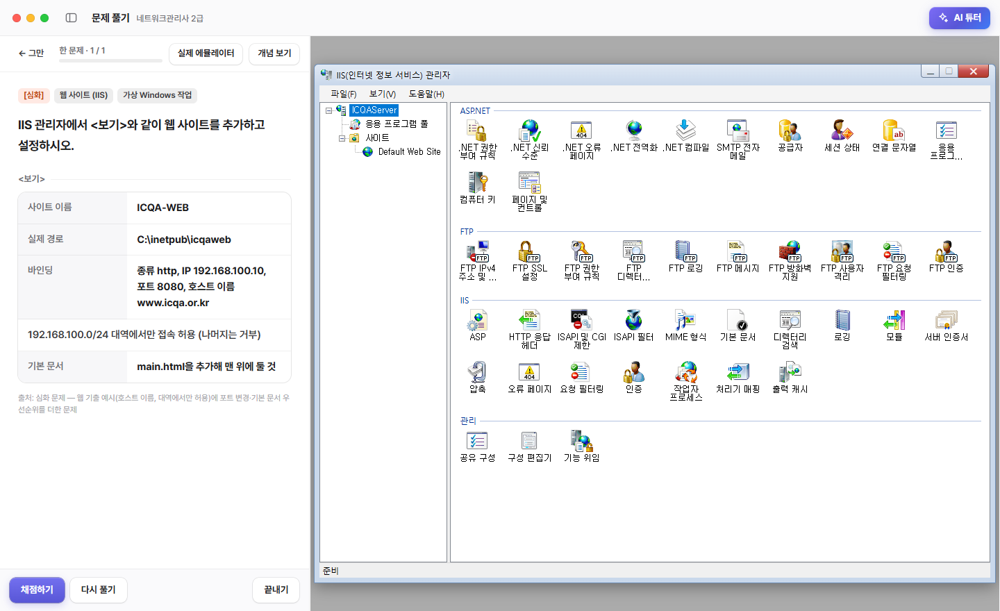
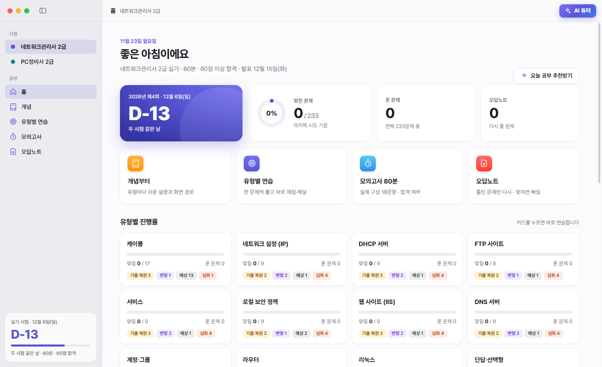
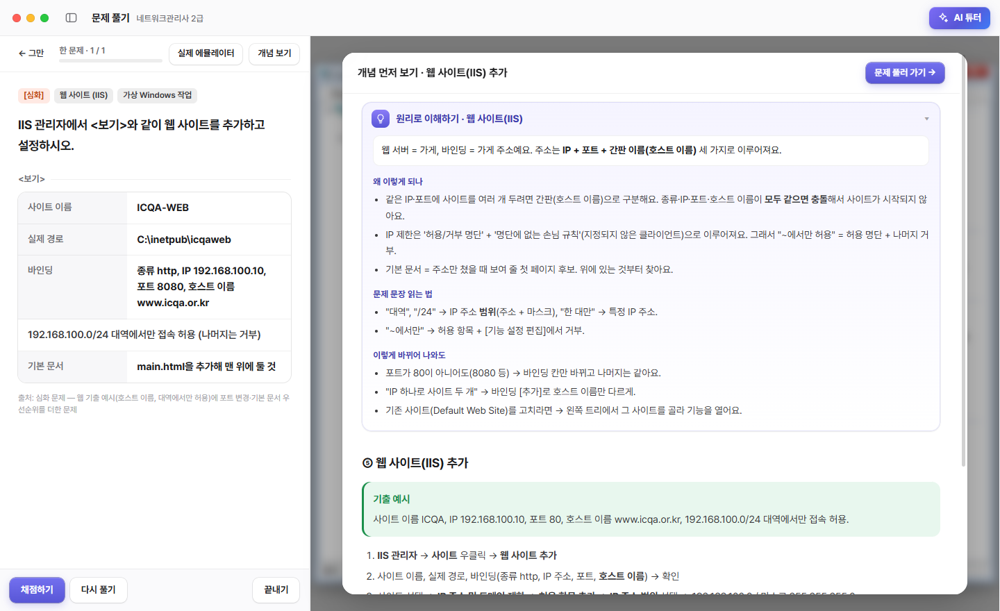
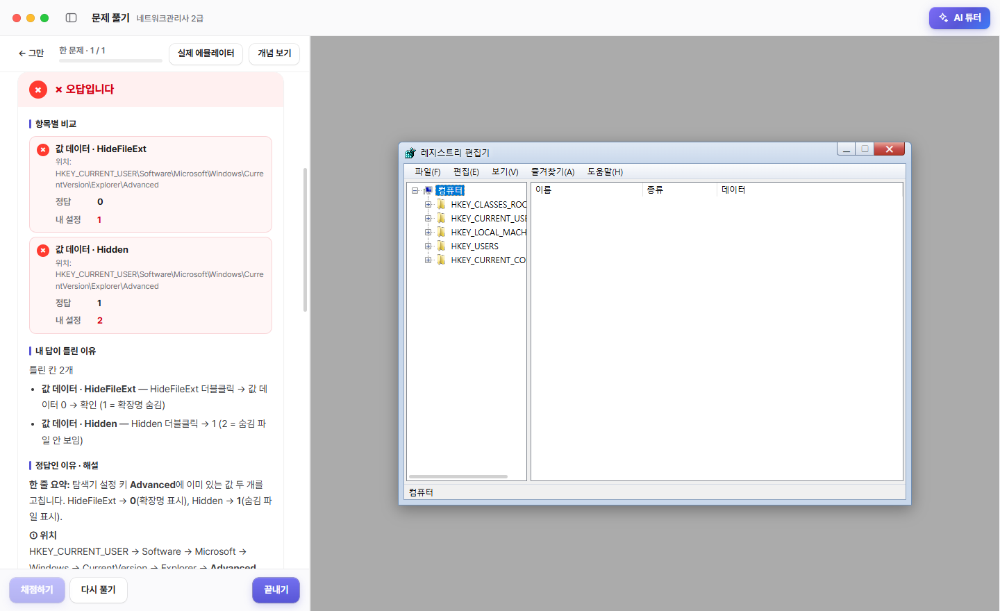
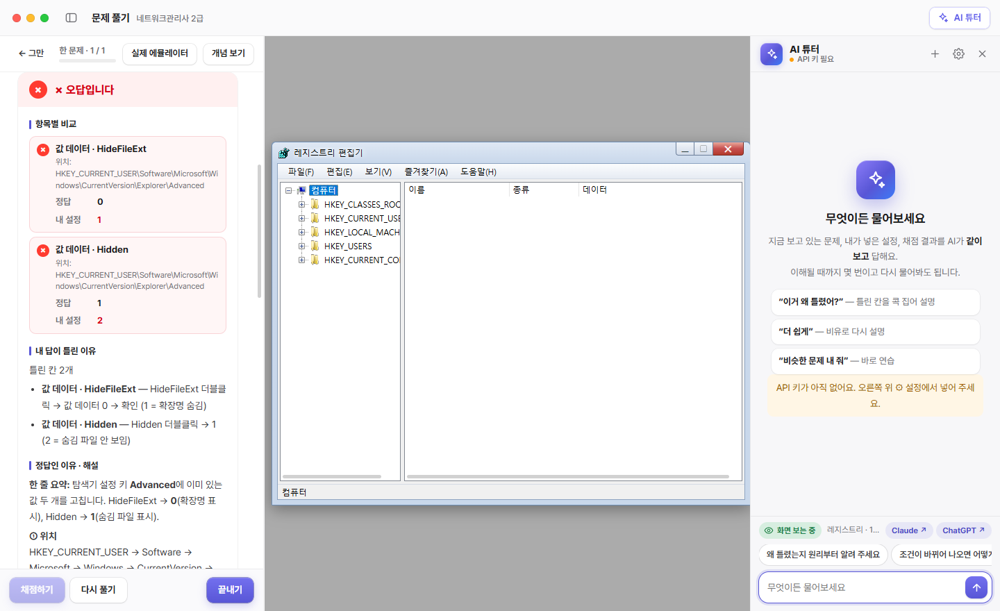
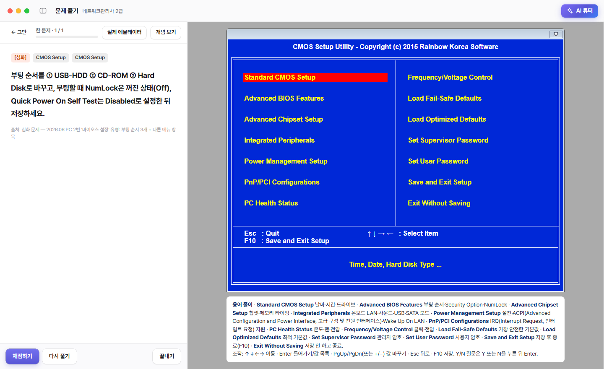
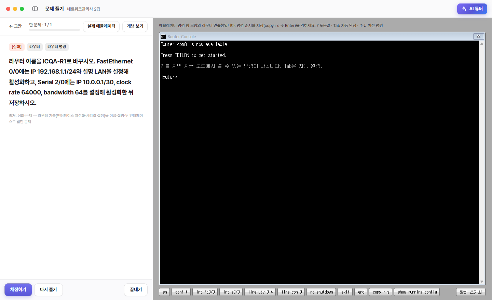

<div align="center">

# 실기 연습

### 네트워크관리사 2급 · PC정비사 2급 실기 연습 프로그램

가상 Windows 화면에서 직접 설정하면 자동으로 채점해 줍니다.<br>
틀린 칸은 **왜 틀렸는지**, 문제가 바뀌어도 풀 수 있게 **원리부터** 설명합니다.

<br>


**[⬇️ 최신 버전 다운로드](../../releases/latest)** · [사용 방법](#-사용-방법) · [AI 튜터 설정](#-ai-튜터-설정-선택) · [자주 묻는 질문](#-자주-묻는-질문)

<br>



</div>

<br>

## ✨ 이런 프로그램이에요

| | |
|---|---|
| 🖥️ **실제 시험 같은 가상 화면** | IIS, DHCP, DNS, 레지스트리, 디스크 관리, CMOS(BIOS), 라우터 명령 창 등 **16가지 Windows 화면**을 실습용 에뮬레이터와 비슷하게 만들었어요. 직접 클릭하고 입력해서 풉니다. |
| ✅ **칸별 자동 채점** | 채점하면 맞은 칸과 틀린 칸을 나란히 보여 주고, 틀린 칸마다 어디서 무엇을 고쳐야 하는지 알려 줘요. |
| 💡 **원리로 이해하기** | 유형마다 "왜 이렇게 되나 → 문제 문장 읽는 법 → 이렇게 바뀌어 나와도"를 정리한 원리 카드가 있어요. 외우는 대신 이해해서 응용 문제도 풀 수 있게요. |
| 🔥 **심화 문제 115개** | 기출을 바탕으로 조건을 비틀고 합친 어려운 문제들. 다 풀면 시험장에서 당황할 일이 줄어요. |
| 🤖 **AI 튜터 (선택)** | 지금 보고 있는 문제·내 설정·채점 결과를 AI가 **같이 보고** 답해 줘요. 이해될 때까지 몇 번이고 물어보세요. |
| ⏱️ **모의고사 · 오답노트** | 실제 구성(18문항, 80분, 60점 합격)대로 모의고사를 보고, 틀린 문제만 모아 다시 풀 수 있어요. |
| 🔒 **오프라인 · 설치 없음** | 인터넷 없이 동작하고(AI 튜터 제외), 파일 하나만 실행하면 됩니다. 기록은 내 PC에만 저장돼요. |

<br>

## 📸 화면 미리보기

<table>
  <tr>
    <td width="50%"><p align="center"><b>홈</b> — D-day, 유형별 진행률</p></td>
    <td width="50%"><p align="center"><b>개념 먼저 보기</b> — 원리 카드와 화면 경로</p></td>
  </tr>
  <tr>
    <td><p align="center"><b>채점 결과</b> — 칸별 비교와 틀린 이유</p></td>
    <td><p align="center"><b>AI 튜터</b> — 내 화면을 보면서 설명</p></td>
  </tr>
  <tr>
    <td><p align="center"><b>CMOS Setup</b> — 키보드로 조작하는 BIOS</p></td>
    <td><p align="center"><b>라우터</b> — 명령어를 직접 입력</p></td>
  </tr>
</table>

<br>

## 🚀 시작하기

### 1. 다운로드

[**Releases**](../../releases/latest) 페이지에서 둘 중 하나를 받으세요.

| 파일 | 설명 |
|---|---|
| `SilgiPractice-x.x.x-portable.exe` | **추천.** 파일 하나. 더블클릭하면 바로 실행돼요. |
| `SilgiPractice-x.x.x-win.zip` | portable이 켜지자마자 꺼질 때. 압축을 풀고 `SilgiPractice.exe`를 실행하세요. |

### 2. 실행

더블클릭하면 끝이에요. 설치 과정이 없습니다.

> [!NOTE]
> 처음 실행할 때 **"Windows의 PC 보호"** 창이 뜰 수 있어요. 개인이 만든 프로그램이라 코드 서명이 없어서 그래요.
> **추가 정보 → 실행**을 누르면 됩니다.

<br>

## 📖 사용 방법

```
① 왼쪽 위에서 시험 고르기   네트워크관리사 2급 / PC정비사 2급
② 개념                     유형별 설명과 원리 카드부터 읽기
③ 유형별 연습               한 문제씩 풀고 바로 채점 · 해설
④ 심화 문제                 유형별 연습 화면 맨 위 → "심화만 모아 풀기"
⑤ 모의고사                  실제 구성 18문항 · 80분 · 합격 여부
⑥ 오답노트                  틀린 문제만 다시 · 맞히면 빠짐
```

**문제 푸는 화면**

- 왼쪽: 문제와 &lt;보기&gt; · 오른쪽: 가상 Windows 화면
- 가운데 경계선을 끌어서 비율을 바꿀 수 있어요.
- **개념 보기**: 문제를 풀다가 막히면 원리 카드를 다시 열어요.
- **실제 에뮬레이터**: ICQA 실습용 에뮬레이터가 PC에 설치되어 있으면, 같은 유형의 실제 에뮬레이터를 바로 열어 줘요.
- **채점하기** 후 틀린 칸이 카드로 정리되고, **AI 튜터에게 왜 틀렸는지 묻기** 버튼으로 바로 질문할 수 있어요.

<br>

## 📚 수록 문제

**총 427문제**(심화 115문제 포함). 문제마다 `기출 복원` · `변형` · `예상` · `심화` 라벨이 붙어 있어요.

<details>
<summary><b>네트워크관리사 2급</b> 유형 보기</summary>

<br>

케이블 · 네트워크 설정(IP) · DHCP 서버 · FTP 사이트 · 서비스 · 로컬 보안 정책 · 웹 사이트(IIS) · DNS 서버 · 계정·그룹 · 라우터 · 리눅스 · 단답·선택형 · 드래그 앤 드롭 · Windows Server 이론

> 모의고사 구성(2026.06.21 복원 기준 18문항): 케이블 1 / 네트워크 설정 1 / Windows Server 7 / 단답·선택·리눅스·드래그 6 / 라우터 3

</details>

<details>
<summary><b>PC정비사 2급</b> 유형 보기</summary>

<br>

케이블 · CMOS Setup · 레지스트리 · 가상 메모리·시스템 속성 · 폴더 옵션 · 디스크 관리 · 원격 데스크톱 · 로컬 보안 정책 · 네트워크 설정(IP) · 장치 관리자 · 프린터 · 공유·권한 · 서비스 · 콘솔 명령 · 단답형 · 선택형 · 드래그 앤 드롭 · BIOS 이론 · 부품

> 모의고사 구성(2026.06.21 복원 기준 18문항): 케이블 / 바이오스 / 레지스트리 / 가상 메모리 / 폴더 옵션 / 디스크 관리 / 단답(서비스) / 원격 데스크톱 / 로컬 보안 정책 / 단답 2 / 드래그 2 / 단답 3 / 선택 2

</details>

> [!IMPORTANT]
> 문제는 수험생 후기를 바탕으로 **복원·예상한 것**이라 실제 시험과 다를 수 있어요. 배점도 후기를 바탕으로 한 근사치예요.
> 시험 전에는 ICQA 공식 실습 에뮬레이터로도 꼭 연습해 보세요.

<br>

## 🤖 AI 튜터 설정 (선택)

AI 튜터는 **OpenAI 호환 API**라면 어디든 연결할 수 있어요. 쓰지 않아도 나머지 기능은 모두 동작합니다.

1. 오른쪽 위 **AI 튜터** → 패널 위쪽 **⚙ 설정**
2. 아래 세 칸을 채우고 저장

| 칸 | 예시 |
|---|---|
| 서버 주소 (Base URL) | `https://api.openai.com/v1` 처럼 `/v1`로 끝나는 주소 |
| API 키 | 사용하는 서비스에서 발급받은 키 |
| 모델 | 저장하면 서버에서 목록을 불러와요. 하나 고르세요. |

> [!TIP]
> **API 키는 안전하게 보관돼요.**
> 키는 내 PC의 `%APPDATA%\SilgiPractice\ai.json`에만 저장되고, 화면(렌더러) 쪽 코드에는 전달되지 않아요. 설정 화면에는 뒤 몇 자리만 보입니다.
> 이 저장소에도 키는 들어 있지 않고, `.gitignore`가 키 파일이 실수로 올라가는 것을 막아요.

- 응답이 느리거나 서버가 바쁘면 자동으로 다시 시도해요.
- 기다리기 싫으면 **Claude / ChatGPT** 버튼으로 질문과 화면 내용을 복사해 브라우저에서 이어 물어볼 수도 있어요.
- 기본으로 들어 있는 서버 주소는 무료 공용 서버라 느리거나 끊길 수 있어요. 가능하면 직접 쓰는 서비스 주소로 바꾸세요.

<br>

## 💾 기록은 어디에 저장되나요?

| 파일 | 내용 |
|---|---|
| `%APPDATA%\SilgiPractice\progress.json` | 푼 문제, 맞힌 문제, 오답노트 |
| `%APPDATA%\SilgiPractice\ai.json` | AI 튜터 설정(서버 주소·키·모델) |

프로그램을 지워도 기록은 남아요. 처음부터 다시 하고 싶으면 이 폴더를 지우세요.<br>
AI 튜터를 쓸 때만 내가 설정한 서버로 질문이 전송되고, 그 밖에는 인터넷에 아무것도 보내지 않아요.

<br>

## ❓ 자주 묻는 질문

<details>
<summary><b>portable 파일이 켜지자마자 꺼져요</b></summary>

<br>

portable 파일은 실행할 때 임시 폴더(`%TEMP%`)에 풀어서 실행하는데, 일부 PC에서는 보안 설정 때문에 임시 폴더 안의 프로그램이 바로 종료돼요.
Releases에서 **zip 파일**을 받아 원하는 폴더에 압축을 풀고 `SilgiPractice.exe`를 실행하세요.

</details>

<details>
<summary><b>"실제 에뮬레이터" 버튼이 안 눌려요</b></summary>

<br>

ICQA 실습용 에뮬레이터가 `C:\Program Files\ICQA\icqaControl`에 설치되어 있을 때만 동작해요. 에뮬레이터는 ICQA 홈페이지에서 받을 수 있어요.

</details>

<details>
<summary><b>AI 튜터가 "API 키 필요"라고 나와요</b></summary>

<br>

위 [AI 튜터 설정](#-ai-튜터-설정-선택)을 참고해 키를 넣어 주세요. AI 튜터 없이도 문제 풀이·채점·해설은 모두 쓸 수 있어요.

</details>

<details>
<summary><b>Mac이나 리눅스에서도 되나요?</b></summary>

<br>

배포 파일은 Windows용만 있어요. Electron 앱이라 소스에서 직접 빌드하면 다른 OS에서도 실행은 될 거예요(확인하지는 않았어요).

</details>

<br>

## 🛠️ 직접 빌드하기

[Node.js](https://nodejs.org/) 20 이상이 필요해요.

```bash
git clone https://github.com/bang9lee/silgi-practice.git
cd silgi-practice
npm install

npm start          # 개발 모드로 실행
npm test           # 채점 자동 테스트
npm run test:ui    # 화면 자동 테스트 (Electron을 띄워 실제로 조작)
npm run test:hard  # 심화 문제 전체 검사
npm run build      # dist\ 에 portable .exe 와 win-unpacked 폴더 생성
```

> [!WARNING]
> VS Code 터미널에는 `ELECTRON_RUN_AS_NODE=1`이 들어 있어서 `npm start`를 해도 창이 안 뜰 수 있어요.
> 먼저 지우고 실행하세요. PowerShell: `Remove-Item Env:ELECTRON_RUN_AS_NODE` / cmd: `set ELECTRON_RUN_AS_NODE=`

<br>

## ✍️ 문제 추가하기

`data\` 폴더의 JSON 파일에 `"questions": [...]`가 있으면 앱이 자동으로 읽어요. 새 파일을 만들어도 됩니다.

<details>
<summary><b>문제 형식 자세히 보기</b></summary>

<br>

| 유형 | `type` | 정답 형식 |
|---|---|---|
| 단답형 | `short` | `"answer": {"accept": ["IPsec", "IP Security"]}` (대소문자·앞뒤 공백 무시, `"cs": true`면 구분) |
| 선택형 | `choice` | `"options": [...]`, `"answer": {"index": 2}`, 보기별 설명 `"optionWhy": [...]` |
| 다택형 | `multi` | `"answer": {"indexes": [0, 2]}` |
| 드래그 | `drag` | `"slots"`, `"items"`, `"answer": {"slots": {"s0": "i0"}}` |
| 케이블 순서 | `cable-order` | `"answer": {"std": "B"}` |
| 가상 화면 | `sim` + `"sim": "dhcp"` 등 | `"answer": {"scope.name": "ICQA"}` — 키 목록은 `src\js\sims\<이름>.js` 맨 위 설명 |

**공통 칸**: `id`, `exam`(net/pc/both), `cat`(유형, `data\exam.json`의 목록), `label`(`기출 복원 …` / `예상` / `변형` / `심화`), `source`(출처), `question`, `box`(&lt;보기&gt;, 한 줄에 조건 하나), `note`, `explain`(해설, `**굵게**`·`` `코드` `` 가능), `why`(가상 화면 칸별 틀린 이유)

**정답 조건 표기**: 값 그대로 / `{"$eq": "ICQA", "$cs": true}` / `{"$any": [...]}` / `{"$has": x}` / `{"$hasAll": [...]}` / `{"$set": [...]}` / `{"$none": true}`

추가한 뒤 `npm test`를 돌리면 키 오타, 처음부터 풀려 있는 문제, 정답이 오답으로 채점되는 문제를 잡아 줘요.

</details>

<details>
<summary><b>폴더 구조</b></summary>

<br>

```
main.js, preload.js      Electron 메인 (창, 데이터 읽기, 기록 저장, AI 요청)
src/index.html           화면
src/css/                 앱 디자인, 가상 Windows, BIOS, 화면별 에뮬레이터 스타일
src/fonts/               Pretendard (OFL 1.1)
src/img/emu/             가상 화면 아이콘
src/js/core/             채점기, 라우터 명령 엔진, 기록 저장
src/js/win7/             가상 Windows 부품 (창·대화 상자·마법사·트리·목록·메뉴)
src/js/sims/             가상 화면 16종 (tcpip, dhcp, iis, dns, secpol, services, users,
                         regedit, console, sysprop, folderopt, diskmgmt, devmgmt, printer, share …)
src/js/app/              앱 화면, 문제 유형, AI 튜터, 라우터·BIOS 화면
data/                    문제, 개념 글, 원리 카드 (JSON)
test/                    자동 테스트
tools/                   예전 웹 버전 자료 변환 도구
```

</details>

<br>

## ⚠️ 알려 드립니다

- 이 프로그램은 **개인이 만든 비공식 학습 도구**이며, 한국정보통신자격협회(ICQA)와 관계가 없어요.
- 가상 화면은 학습을 위해 Windows와 ICQA 실습 에뮬레이터의 화면 배치·아이콘을 비슷하게 재현한 것이에요. 각 상표와 아이콘의 권리는 원래 주인에게 있어요. 권리자의 요청이 있으면 바로 지우겠습니다.
- 문제·해설에 틀린 내용이 있을 수 있어요. 발견하면 [Issues](../../issues)에 알려 주세요.

<br>

## 📄 라이선스

소스 코드는 [MIT License](LICENSE)를 따릅니다. 단, 아래는 제외예요.

- `src/fonts/` — [Pretendard](https://github.com/orioncactus/pretendard), SIL Open Font License 1.1
- `src/img/emu/` — Windows / ICQA 실습 에뮬레이터 화면에서 재현한 아이콘 (각 권리자 소유)

<br>

<div align="center">

**모두 합격하세요! 🍀**

</div>
